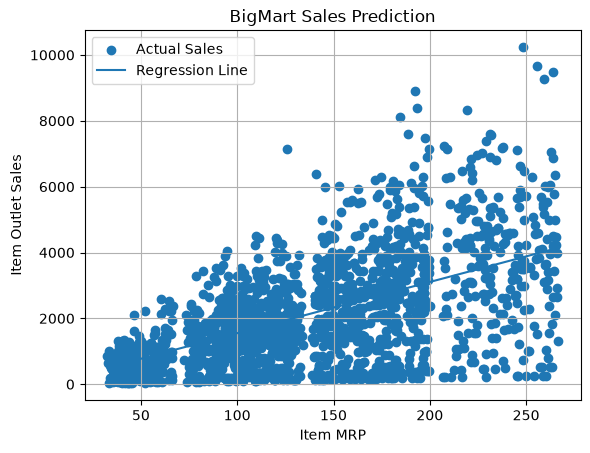

# BigMart Sales Prediction

A beginner-friendly machine-learning project that trains a linear regression
model to predict outlet sales from an item's maximum retail price (MRP).

## Project files

- `BigMart_Sales_Prediction.py` — loads the dataset, trains and evaluates the
  model, predicts sales for an item with an MRP of 150, and plots the results.
- `bigmart.csv` — the BigMart sales dataset used by the script.
- `BigMart_Sales_Prediction_Output.txt` — sample console output from running the
  script.
- `BigMart_Sales_Prediction_Output.png` — chart generated by the script.

## Sample output

The captured console output is available in
[`BigMart_Sales_Prediction_Output.txt`](BigMart_Sales_Prediction_Output.txt).
The chart below is generated by the script:



## Requirements

- Python 3
- pandas
- matplotlib
- scikit-learn

Install the required packages with:

```bash
python -m pip install -r requirements.txt
```

## Run

Run the script from this project's directory so it can find `bigmart.csv`:

```bash
python BigMart_Sales_Prediction.py
```

The script prints the dataset preview and model evaluation, predicts sales for
an item with an MRP of 150, saves the chart as
`BigMart_Sales_Prediction_Output.png`, and displays the chart when a graphical
display is available.
